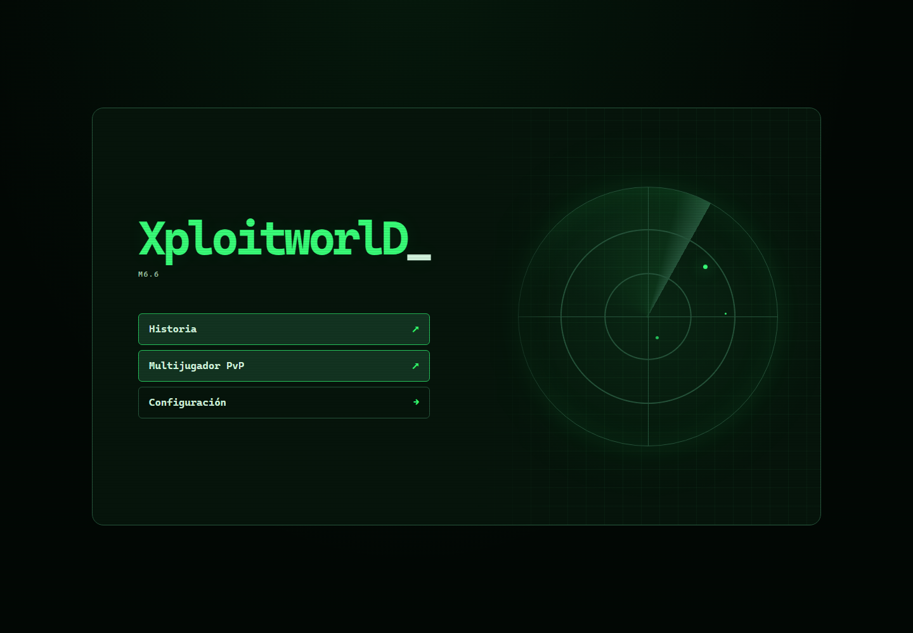
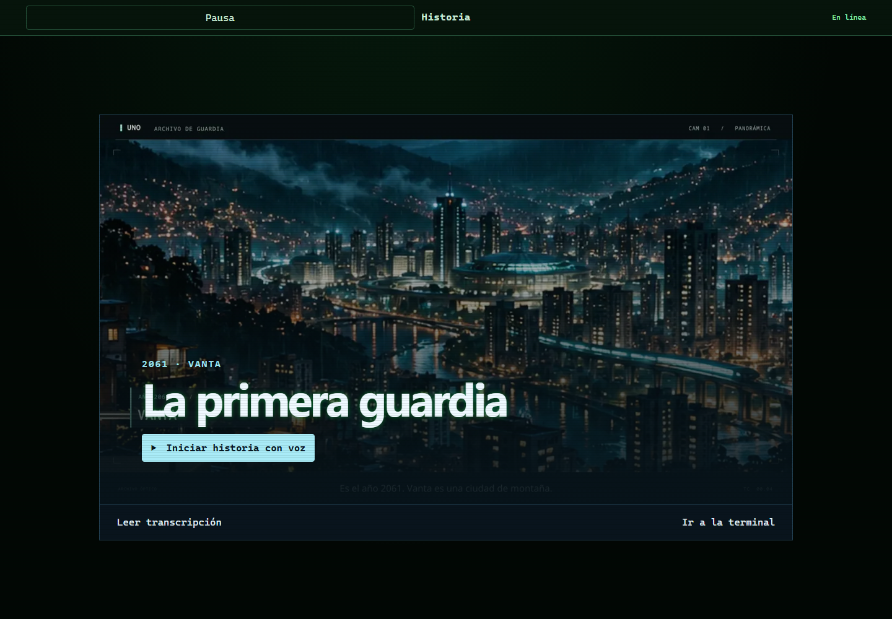
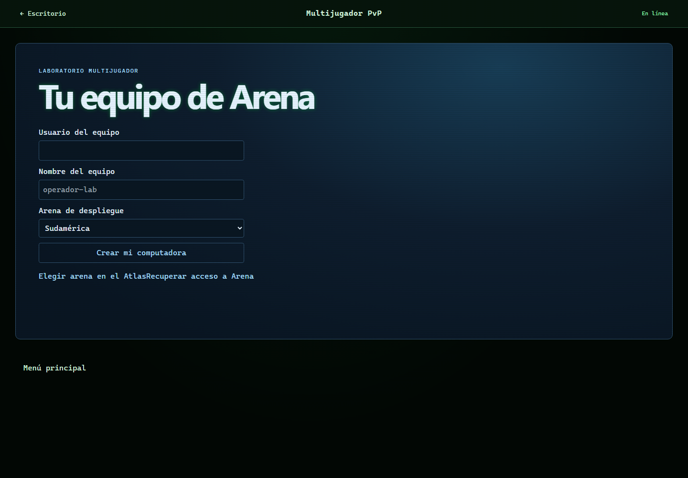

# XploitworlD · M6.6

El menú principal abre dos juegos con servidores y guardados propios. **Historia** sigue la investigación de Vanta en la campaña UNO. **PvP** abre tu computadora de Arena con archivos personales, dispositivos, Atlas, herramientas defensivas y contratos.



## Primera partida en Windows

Necesitas **Node.js 24.15 o posterior de la rama 24**, **pnpm 9.15.9** y **Docker Desktop con Compose v2**. Abre Docker Desktop y espera a que su motor esté listo. Abre PowerShell en la carpeta que contiene `pnpm-lock.yaml`.

**1. Prepara la configuración local.** Git conserva las plantillas, no tus credenciales. Estos comandos solo crean los archivos que faltan; no reemplazan los de una instalación existente.

```powershell
if (!(Test-Path apps/backend/.env))     { Copy-Item apps/backend/.env.example apps/backend/.env }
if (!(Test-Path apps/backend/.env.pvp)) { Copy-Item apps/backend/.env.pvp.example apps/backend/.env.pvp }
if (!(Test-Path apps/frontend/.env))    { Copy-Item apps/frontend/.env.example apps/frontend/.env }
```

**2. Instala las dependencias e inicia el juego.** La primera ejecución necesita Internet para descargar dependencias, imágenes de PostgreSQL y el motor de Prisma.

```powershell
pnpm install --frozen-lockfile
pnpm jugar
```

**3. Abre el menú en <http://127.0.0.1:5173>.** Espera a que la terminal indique que Historia y PvP están escuchando. Déjala abierta mientras juegas; `Ctrl+C` detiene la sesión. La próxima vez basta con abrir Docker Desktop y ejecutar `pnpm jugar`. Si vienes de M6.4, lee [cómo migrar tu partida](SETUP_GUIDE.md#actualizar-desde-m64) antes de entrar en los nuevos modos.

| Servicio local | Interfaz | API | PostgreSQL |
| --- | --- | --- | --- |
| Menú | 5173 | — | — |
| Historia | 5174 | 3000 | 5434 |
| Arena PvP | 5175 | 3001 | 5433 |

Las partidas se guardan en los volúmenes locales de PostgreSQL, **no en GitHub**. No borres esos volúmenes si quieres conservar el progreso.

Para jugar en la misma Wi-Fi, comparte la dirección de red del menú en el puerto 5173. El arranque de desarrollo autoriza las IPv4 del equipo y el menú abre Historia en 5174 y PvP en 5175 sobre esa misma dirección. Consulta [Acceso por la red local](SETUP_GUIDE.md#acceso-por-la-red-local).

## Historia



La primera partida abre **La primera guardia**, una cinemática con voz, subtítulos y transcripción en español o inglés. Pulsa **Iniciar historia con voz**. Al terminar, el juego abre la terminal automáticamente. Desde **Pausa → Partidas guardadas** puedes volver a ver la introducción.

- `cat README.txt` abre el encargo de la guardia.
- `echo "nota.txt"` abre el editor. Ctrl+O guarda y Ctrl+X cierra.
- `mission continuar` retoma el siguiente escenario. `hint` ofrece una pista y `check` entrega la evidencia de campaña.
- En **Pausa → Exchange** están la tienda, el inventario y las recompensas de Historia. El taller abre la misión 1.08. El SSD abre la 5.05 y amplía la capacidad de archivos.
- Los expedientes de práctica, los archivos de trabajo y el progreso se guardan en Historia.

## PvP



Crea un usuario y un nombre de equipo para ver tu escritorio. Las herramientas de defensa vienen instaladas. Desde el escritorio se abren la terminal, los archivos, el Atlas, el dispositivo y los contratos. La terminal opera sobre los archivos de Arena. Escribe `help` para ver las utilidades y `export-log nota.txt` para guardar una copia de la bitácora de tu equipo.

En **Atlas de señales** puedes desplegarte en 208 ubicaciones de capitales y sedes. Usa el mapa o el directorio para ver la hora, el aforo, la actividad y las reglas de cada arena. Filtra por cupos libres y alterna entre la actividad de la capital seleccionada y la global. Puedes pulsar cada barra del gráfico para consultar su desglose horario. Al trasladar tu equipo cambian tu red virtual y los rivales visibles. Consulta el [diseño y las fuentes del Atlas](docs/ATLAS.md).

Los **BTC de Arena** se usan en contratos entre operadores. La plataforma retiene el pago, valida la entrega sobre el activo autorizado y aplica los cambios de mantenimiento o recuperación al equipo del cliente. El operador vincula su cuenta de Arena en **Contratos**. El laboratorio usa simulaciones defensivas y redes virtuales del juego.

Para alojar el menú y ambos modos, sigue la [guía del servidor completo](docs/SERVIDOR_COMPLETO.md). Incluye la configuración automática de las dos bases, HTTPS y la ruta para reemplazar la introducción. La [guía de pruebas PvP](docs/PRUEBAS_REMOTAS.md) documenta la conexión entre operadores.

## Diario, prácticas y desafío de guardia

Desde **Historia → Pausa → Partidas guardadas**, elige un capítulo en el diario. Puedes abrir una misión disponible y repetir las ya completadas. El diario muestra el requisito de las bloqueadas y enlaza al equipo necesario cuando corresponda.

En **Historia → Pausa → Prácticas**, selecciona **La copia de guardia**. Está disponible desde una partida nueva. Verifícala para abrir **El ensayo de regreso**. Cada práctica aprobada permite descargar su informe o guardarlo en los archivos de Historia. Las aprobaciones nuevas conservan las decisiones correctas y las tablas de evidencia en los dos idiomas. Las partidas anteriores conservan la fecha y el número de intentos registrados.

En **PvP → Escritorio → Archivos** puedes crear carpetas, editar notas, importar imágenes y eliminar entradas. En **Desafío de guardia**, revisa los cuatro criterios, abre **Configurar dispositivo** y vuelve para evaluar el resultado. La primera aprobación otorga una insignia personal de Arena.

Para actualizar una instalación existente, ejecuta `pnpm jugar` con Docker Desktop abierto. El arranque aplica la migración a las dos bases antes de abrir el juego.

## Si el juego no abre

| Mensaje o síntoma | Qué comprobar |
| --- | --- |
| `ENOTFOUND binaries.prisma.sh` | Prisma no pudo resolver el servidor de descarga. Ejecuta `Resolve-DnsName binaries.prisma.sh`. Cuando vuelva a resolver, reintenta `pnpm jugar`; no hace falta borrar las dependencias. |
| `ws proxy error: ECONNREFUSED 127.0.0.1:3001` | Si aparece durante un reinicio, espera a `pvp listening` y recarga PvP. Si persiste, abre <http://127.0.0.1:5175/health>. Debería indicar `status: ok` y `mode: pvp`. Si no responde, revisa el primer error del backend en la terminal antes de cambiar el proxy de Windows. |
| Docker no arranca o el menú no aparece | Comprueba que `docker info` responde y usa `docker ps` para ver si ambas bases están `healthy`. Si ya lo están, busca el primer error posterior en la salida de `pnpm jugar`. |

## Desarrollo y comprobación

```powershell
pnpm check
```

La compilación genera tres sitios en `apps/frontend/dist`. Consulta la [guía de instalación y despliegue](SETUP_GUIDE.md) para arrancar cada modo de forma independiente, migrar una partida y ejecutar las pruebas con PostgreSQL.

El código mantiene la declaración de licencia privada del proyecto original. La [ficha de la cinemática](docs/CINEMATICA_VANTA.md) documenta las voces y los archivos incluidos.
